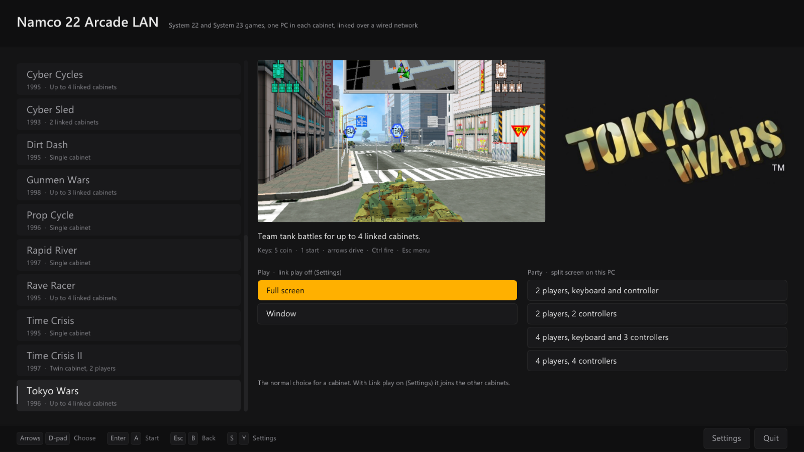
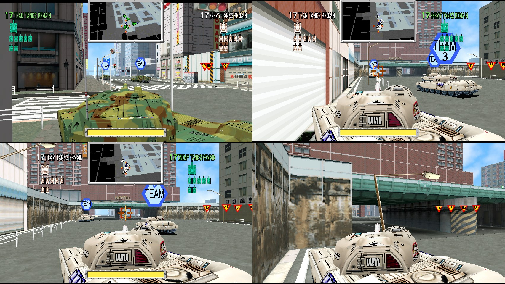
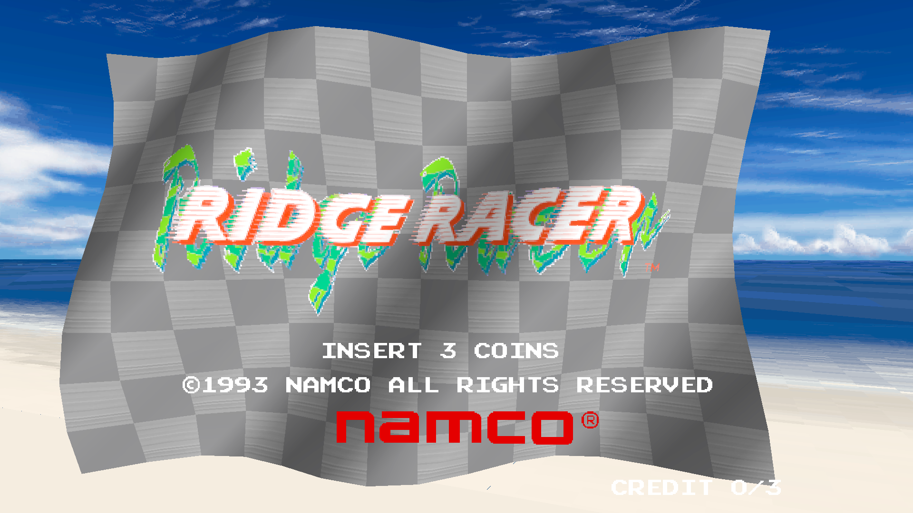
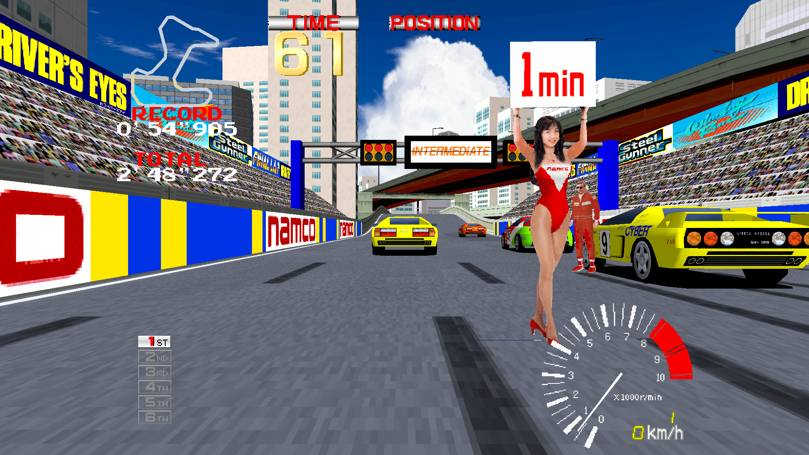
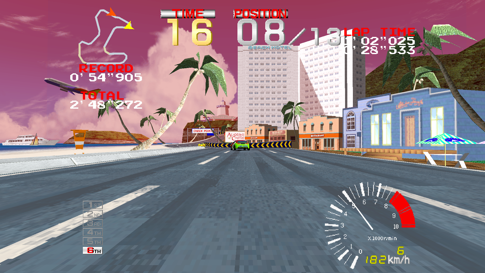
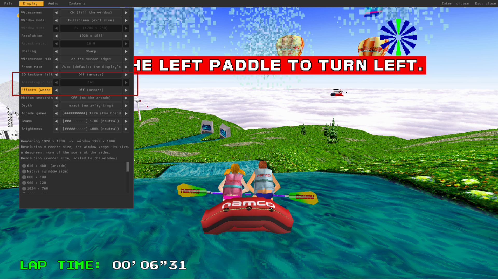
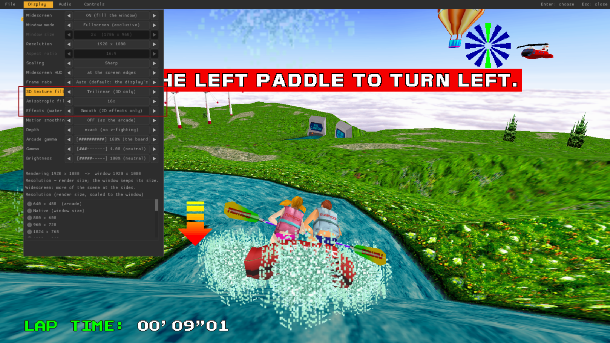

# Namco 2x: Arcade Custom Decompiled Version with LAN support made by [LuKa-86](https://github.com/LuKa-86/namco22-arcade-lan) and various game fixes plus Ridge Racer full decompiled and advanced texture filtering (bilinear/sharp bilinear/trilinear or sharp trilinear+anisotropic 2x-4x-8x-16x) made by [PantaRei1983](https://github.com/PantaRei1983)

**A fork of [namco22-decompile](https://github.com/spacestate1/namco22-decompile) by
[spacestate1](https://github.com/spacestate1), made to keep real arcade cabinets running.**

namco22-decompile rebuilds Namco's 1990s 3d arcade games (System 21, 22, Gorgon and 23) so they run natively on a PC. All of that
work is spacestate1's. The [LuKa-86](https://github.com/LuKa-86/)'s fork puts those games into real cabinets: a PC in place of the original boards, the
cabinets linked over a wired network the way the boards were linked by their cable, starting by themselves when the
cabinet is switched on, added full decompiled version of one of two Namco Gorgon (early System 23 family) games (Rapid River), one new System 23 game (Gunmen Wars), and all other Super System 22 games (Air Combat 22, Alpine Racer, Alpine Racer 2, Alpine Surfer, Aqua Jet, Cyber Cycles) and one new System 22 game (Ace Driver: Victory Lap). My fork added a full decompiled version of Ridge Racer (based on latest "ridgerac" main romset of MAME v0.289) various game fixes (especially on Prop Cycle, that now have full attract mode and correct replay working) and introduce new filter options on texture game (bilinear/sharp bilinear/trilinear or sharp trilinear+anisotropic 2x-4x-8x-16x). In this fork all Namco System 22/Super System 22 games are decompiled! Huge respect and thanks to spacestate1; please star and support
[the original project](https://github.com/spacestate1/namco22-decompile), and use it for playing at home or online.

**You need your own copy of the games.** This repository contains no ROMs or game data.

## Why this exists

The original boards in these cabinets are 25 to 30 years old. They fail, spares are scarce, and a linked set is only as
good as its weakest board. This project started as a way to **restore a 4-player linked Tokyo Wars set-up** and has
grown into a way to **keep other Namco machines of that era running** with a modern PC in each cabinet.

The goal is **set up and forget**: switch a cabinet on, and its PC boots, starts its game full screen, finds the other
cabinets on the network and links with them, with nobody touching a keyboard, every day.

> **Project status:** a hobby project, with no regular updates or support. The link has been tested on three real PCs
> on one network switch, and with up to four copies on one PC; it has not yet run in a full arcade installation. Bug
> reports and pull requests are welcome but may not get picked up. You are welcome to fork it under the same licence
> (MIT).

<p align="center">
  
</p>

## The games

**Linked** means cabinets on the network play together, as the original boards did over their link cable.
**New** means the game is not in the original project: this fork ported it.

| Game | Year | Board | Cabinets | |
|---|---|---|---|---|
| **Tokyo Wars** | 1996 | Super 22 | up to 4, linked | Team tank battles |
| **Rave Racer** | 1995 | System 22 | up to 4, linked | Linked races |
| **Ace Driver** | 1994 | System 22 | up to 8, linked | Linked races; the link is **new** (the original project's build plays solo) |
| **Ace Driver: Victory Lap** | 1996 | System 22 | up to 4, linked | **New** port. Up to 8 is in the code but not yet reliable |
| **Cyber Cycles** | 1995 | Super 22 | up to 4, linked | **New** port |
| **Cyber Commando** | 1994 | System 22 | 2, linked | Robot battles; the link is **new** |
| **Armadillo Racing** | 1997 | Super 22 | up to 4, linked | Trackball racing; the link is **new** |
| **Alpine Racer 2** | 1996 | Super 22 | 2, linked | **New** port; head-to-head races, party mode |
| **Cyber Sled** | 1993 | System 21 | 2, linked | Hover-tank battles; **cabinet link** is new (the original links only online) |
| **Time Crisis II** | 1997 | System 23 | 2, the twin cabinet | Left and right sides linked for two players; party mode |
| **Gunmen Wars** | 1998 | System 23 + GMEN | up to 3, linked | **New** port; team shoot-outs, NamCam photo from a webcam, party mode |
| **Alpine Racer** | 1995 | Super 22 | 1 | **New** port |
| **Alpine Surfer** | 1996 | Super 22 | 1 | **New** port |
| **Air Combat 22** | 1995 | Super 22 | 1 | **New** port; jet-fighter missions |
| **Aqua Jet** | 1996 | Super 22 | 1 | **New** port |
| **Rapid River** | 1997 | Gorgon (System 23 family) | 1 | **New** port; white-water rafting |
| **Ridge Racer** | 1993 | System 22 | 1 | **New** Port |
| **Crisis Zone** | 1999 | System 23 Evolution 2 | 1 | Built by this fork, with widescreen and graphics fixes |
| **Prop Cycle** | 1996 | Super 22 | 1 | The original project's game, with various fixes: attract mode with story and replay fully working |
| **Dirt Dash** | 1995 | Super 22 | 1 | The original project's game, built here from its 0.10.3 source |
| **Time Crisis** | 1995 | Super 22 | 1 | The original project's game, built here from its 0.10.3 source |

Every linked game has been tested linking several copies on one PC. Tokyo Wars, Rave Racer, Cyber Cycles,
Time Crisis II and Gunmen Wars have also been tested linking across three real PCs.

## Fixes and improvements over the original project

### The cabinet link (made by LuKa-86)

- **A local-network link** for 11 games, modelled on Namco's own link chips (the C139 on System 21/22, the C422 on
  System 23, the GMEN board's FireWire link for Gunmen Wars). The games run their original link code unchanged.
- **Links at power-on, like the boards.** Cabinets wait up to a minute for each other, then start together. A cabinet
  that starts late or restarts plays alone until the set is restarted, as on the real hardware.
- **Finds the other cabinets by itself.** *Find cabinets* on the Network page fills in every PC's address, and the
  Network page is the same in every linked game.
- **Works without a router.** PCs wired to a plain switch use Windows' automatic addresses (169.254.x.x) and still link.
- **Copes with PCs that have several network connections** (Wi-Fi, VPNs such as Tailscale, virtual adapters): replies go
  back out of the connection the other cabinet was heard on, so a VPN can't steal the link.
- **Safety net:** if its partners disappear, a cabinet shows *LINK LOST - RESTARTING* and starts again, alone, instead
  of being stuck in a battle nobody else is in.
- **Link lights:** small status lights in a corner of the screen, one per cabinet, for setting up.
- **Several copies on one PC** pace themselves by timer, so background windows don't lag (for testing and party mode).
- **LAN test kit:** three .bat files that run a test on every PC, collect the logs on one PC and print a plain report
  (linked or not, one-way links, lost links, link quality, a PC running too slow).

<p align="center">
  
</p>

### Running in a cabinet (made by LuKa-86)

- **A full-screen launcher** (`Namco 22 Arcade LAN.exe`) for every game, driven by keyboard, controller or mouse.
- **One Link play switch** in the launcher's Settings, **off** out of the box: every game simply starts and plays. Turn
  it on for a PC that is part of a linked set and its games look for the other cabinets first (Start or S skips the
  wait). The launcher sets each game's own Link play setting to match whenever it starts one.
- **Starts a game when Windows starts**, and **starts it again if it ever closes**, so the cabinet always comes back to
  its attract mode.
- **Arcade mode:** the original project's online pages are hidden. Coins and Start work as on the original machines;
  each game's test-menu settings (cabinet ID, team colour and so on) are kept per cabinet.
- **Esc only opens and closes the menu** (the original's double-Esc quits, which a cabinet does not want).
- **Session recordings:** each game keeps the last session's inputs, so a problem can be replayed exactly. **F9** saves a
  picture and a replayable capture of a glitch. A crash keeps its recording and log.
- **Party modes:** 2 or 4 players on one PC, split screen, a controller each.

### Game fixes made by LuKa-86

- **Victory Lap:** collision tables and race crashes fixed; test mode works; the rev needle is no longer dimmed.
- **Air Combat 22:** crashes in attract, at mission end and after the mission 2 refuel fixed; stuck sprites fixed; pitch
  and throttle can be rebound; the gunsight's pitch ladder no longer cuts thin lines through the TIME LIMIT / SCORE text
  in the second attract demo (the polygon-over-text mask now stays inside each polygon's clip window).
- **Crisis Zone:** widescreen HUD with the score bars at the screen edges; 4:3 with fading bars outside play; tank
  shadow colours fixed; HUD icons drawn over the bars; zone-select ticker scrolls on its own.
- **Gunmen Wars:** the namco logo matched to real-cabinet footage; widescreen HUD; NamCam from a webcam or a picture.
- **System 23 engine:** about 4 times faster priority drawing; correct texture sampling for some polygons.
- **Super 22 / System 22:** translucent sprites over text; priority of some polygons over the text layer; guard-band
  polygons drawn.
- **Menus:** quick clicks and touchpad taps are no longer lost; a controller's D-pad moves one row, not two.

### New game, Texture filters and fixes from PantaRei1983's namco22-decompile fork

- **Ridge Racer (new port):** MAME's `ridgerac` set (World, RR2 Ver.B), on the Ridge Racer 2 / Rave Racer runtime, with the
  master DSP and sound MCU interpreted (as Victory Lap). Two fixes it needed, shared by every 68020 port:
  - The translator (`tools/gen/lift68k.py`) rewrites `cmp2` / `chk2`: Ghidra reads the bounds through a pointer it loads from
    the effective address (they are AT it), compares the whole data register, and reads a PC-relative pair 2 bytes early.
    Ridge Racer's course culling uses it, and drew no road or ground until it was fixed. Re-run a game's `tools/regen.sh`
    to get the fix in its translation.
  - The translator also keeps the 68000's X flag: CMP / CMPI / CMPA / CMPM leave it alone and ADDX sets it (Ghidra does the
    opposite). Ridge Racer's BCD lap time gained a minute at every lap -- the same bug Ridge Racer 2's first translation had
    (fixed there after the fact).
  - `abcd` / `sbcd` in their memory form (`-(Ay),-(Ax)`) are decimal too: Ghidra's p-code left them binary, so Ridge
    Racer's gold TIME countdown went 50 -> 4F -> 4E ... and drew the wrong digit tiles. Now 50 -> 49.
  - Vertex lighting (point ROM packet 0x10) follows MAME's current `namcos22_v.cpp` (after 0.289): flat or Gouraud, the mesh
    width, triangles and the packet's own intensity, the normal index advancing once per quad. The waving flag in the
    attract mode and the rotating sign before the second tunnel are smoothly lit; the same code draws Prop Cycle's
    score / time, Time Crisis' knives and Armadillo Racing's title logo.
  - Build: `ridgerac/build.sh ridgerac.zip namcoc74.zip` (unpacks the ROMs), then `ridgerac/tools/import.sh` once with
    `N22TOOLS` set (Ghidra translates the program), then `ridgerac/build.sh` again. Start it with `./launch.sh rr1`.
  <p align="center">  
  
  
  
  </p>
- **3D texture filter (Display > 3D texture filter)** for every textured game: **Off, Bilinear, Sharp bilinear, Trilinear,
  Sharp trilinear**, with **anisotropic filtering 2x / 4x / 8x / 16x** in the trilinear modes. Only the 3D polygons are
  filtered: the HUD, the text layer and the 2D sprites stay sharp. It replaces the Texture smoothing switch: Alpine
  Racer 2 and Alpine Surfer still start with Bilinear, and an older `texture_smoothing` line in a game's cfg is still read.
  - Super 22 / System 22 and Prop Cycle: atlas pages with mip levels; the sharp modes run in a small fragment shader.
    Config: `texture_filter` = `off | bilinear | sharp | trilinear | sharp-trilinear`, `texture_aniso`. Environment:
    `ENG_TEX_FILTER` = 0..4, `ENG_TEX_ANISO`.
  - System 23 / Gorgon (Time Crisis II, Crisis Zone, Angler King, Gunmen Wars, Rapid River, Final Furlong): filtered per fragment in the polygon
    shader, kept inside each polygon's own texels; never Gunmen Wars' photo page. Immediate polygons are filtered when they are 3D
    (corners at different depths: Final Furlong's horses and saddle-cloth numbers); flat screen panels stay sharp. Environment: `S23_TEX_FILTER`,
    `S23_TEX_ANISO`.
  - Rave Racer has its own Display rows for the same filters. Cyber Sled has no textures, so no filter rows.
- **Effects (Display > Effects):** smoothing for the 2D effect sprites of Air Combat 22 (smoke and explosions), Cyber Commando
  (smoke and explosions), Dirt Dash (dust, mud, spray and a softer headlight glow on the car select screen), Prop Cycle, Time Crisis,
  Tokyo Wars (smoke, fire, sparks), Armadillo Racing (dust), Alpine Racer 2 (the snow spray, ice chips and clumps of earth
  thrown up by the skis) and Aqua Jet (the spray thrown over the screen's edges while riding, and the wall of water under the waterfall).
  - Effects are matched by the tile a sprite actually draws. Alpine Racer 2 draws its spray as linked sprites (tile 0
    plus a word from the link table), so the base tile alone would not tell them apart. `ENG_SPRLOG=-1` lists every
    sprite of every update, with both numbers.
  - Cyber Commando (System 22): a Display > Effects row smooths the explosions, which on System 22 are textured polygons (texture bank 5,
  u 0..511, v 1024..1535; `fx_tex` in the game table).
  - Rapid River (Gorgon): the water spray and foam sprites. With the option on, each sprite tile is drawn as a filtered
    quad at the output resolution, with no seams between tiles, instead of being stretched with nearest-neighbour
    sampling. Other sprites (HUD, title, text) stay sharp. Config: `effects_filter` = `off | on`. Environment:
    `S23_FX_FILTER` = 0 | 1.
  <p align="center">  
  
  
  </p>
- **Crisis Zone:**
  - The zone select's beam counter is read in System 23 Evolution 2's format (a line count from the start of vblank),
    so the game's own wait puts the ticker's scroll on the ticker rows only. This replaces the fixed row cut-off.
  - That wait is fast-forwarded line by line, so the screen holds 60 fps.
  - The attract demo's RULES panels ("PRESS PEDAL : GO&SHOOT", "OUT OF AMMO", ...) are shown. They are direct quads,
    and the buffer is decoded again; the full-screen quad and letterbox bars that the game keeps there with bit 15 set
    are skipped.
- **Prop Cycle:** the end-of-game replay of the player's own run is in sync again.
- **Prop Cycle:** the story intermissions and the good ending draw their whole cast. The rewrite stopped every walk of
  the animation chain at 64 nodes; the ROM has no limit, and these scenes go past it (68 nodes after day 2, up to 81
  after day 3, 71 in the ending). The last group loaded lost its last nodes: the boy's head after day 2, the old man's
  head, arms or whole upper body after day 3. `PROPCYCL_LEVEL=inter:<day>` jumps straight to the intermission after a
  day, and `PROPCYCL_NODEDUMP=<frame>` lists the chain's nodes at that frame.
- **Prop Cycle:** the attract mode plays the story introduction again ("IN THE FUTURE PEOPLE LIVE IN PEACE..." to "IS
  THE HERO OF SOLITAR!", nine scenes, about 35 seconds). It was never ported: the attract's step 14 called another
  scene's code, which ended at once, so the story was skipped. `src/game_story.c` ports it from the ROM (0x0300AC..
  0x03164C), and the sacred altar picture gets its frame number again. `PROPCYCL_SHOT_FROM` / `PROPCYCL_SHOT_TO` limit
  `PROPCYCL_SHOT_EVERY` captures to a range of frames.
- **Ridge Racer 2:** the lap time no longer gains a minute (the 68000 X flag in the lifted code).
- **Prop Cycle: no more flickering fountain spray and black river in the attract's ranking flight over the town** (before the
  Savior of Solitar plate): the water surface's animation frame was read wrongly (a 68020 memory-indirect address), so it
  cycled through other water models -- spray, flow, nothing -- instead of its eight still-water frames.
- **Alpine Surfer: READY slides in and GO! slides out, row by row, as on the board.** The Super System 22 engine now has the
  scanline interrupt (posirq) and a text layer scrolled line by line: the game moves each pixel row of the word in its
  interrupt handler (MAME: "alpines changes x scroll mid-screen"). Other games that enable the interrupt (Air Combat 22,
  Alpine Racer, Aqua Jet, Dirt Dash) draw exactly as before. `SS22_NO_POSIRQ=1` turns it off for a comparison.
- **Rapid River and Gunmen Wars build on Linux in one step:** `rapidrvr/build.sh` and `gunwars/build.sh` (new) unpack the ROM
  zips, translate the program with Ghidra when `N22TOOLS` is set, and build; `./launch.sh rapid` / `./launch.sh gunmen` start
  them. Their import / regen scripts were Windows-only. Every `.sh` in the repository is now executable (several were not, so
  `./launch.sh` itself failed on Linux with "Permission denied").
- **Sprites of the VICS games (Air Combat 22, Armadillo Racing, Dirt Dash, Time Crisis, Tokyo Wars):** the VICS chip now works as
  on the board (MAME PR #16658): in the vblank it copies the sprites the game wrote into the sprite chip, which draws its own list. The
  guessed sprite counts and the per-game fixes are gone; sprites show one frame after the game wrote them, as on the hardware (visible in
  Air Combat 22's gunsight). `SS22_VICS_DMA=0` brings the old drawing back for a comparison.
- **Effects for Alpine Racer, Alpine Surfer and Cyber Cycles:** Display > Effects now smooths the snow the skis and the board throw
  up, and Cyber Cycles' sparks, gravel and tyre smoke -- every Super System 22 game has the option now. Alpine Surfer's and Cyber
  Cycles' translation scripts also run on Linux.
- **Widescreen (all Super System 22 games):** a sprite that runs past the 4:3 edges now goes on into the wider picture instead of
  stopping in a straight line. Aqua Jet's riding spray, which the game lays exactly across the 640-px screen, is continued (mirrored) out to
  the picture's edges (`edge_fill` in the game table).
- **Air Combat 22:** Display > Effects smooths the explosions and the smoke (sprite art 2100..3583). Its translation scripts
  (`airco22/tools/*.sh`) also run on Linux now.
- **Ridge Racer 2:** the test menu's GAME OPTIONS and COIN OPTIONS change again (gas held, wheel left / right) and are saved when the
  Test switch goes off: the four `cmp2.b` of the lifted code read their bounds from a wrong address, so every step "wrapped" and the
  value flickered between two settings (namco22-decompile issue #101). `ridgera2/tools/gen/fix_cmp2b.py` rewrites them.
- **Widescreen fog (System 22 games):** the depth fog of a quad past the 4:3 sides is taken as far as the frame's edge would
  see it. The fog level is the depth along the view axis, so the sky panels out to the side -- seen only in a wider picture --
  had less of it: Ridge Racer's sunset (red) and dawn (white), which are fog on the sky dome, left a blue strip of sky at the
  picture's edges. Inside the 4:3 frame nothing changes, and 4:3 is untouched.
- **Alpine Racer 2:** the title's ice block turning into the "Alpine Racer 2" ice logo is drawn. It is a point-RAM object
  (code 5) that a PDP block inside the display list writes on the fly: the block is run (MAME `simulate_slavedsp`), Super 22
  geometry reads point RAM (0xF80000), and a model's list address comes from its point word for every code, as MAME's
  `blit_polyobject`.
- **Alpine Racer from any of MAME's sets:** `alpinerd` (World AR2 Ver.D, the parent), `alpinerc` or `alpinerjc` -- the port
  was written for alpinerjc only, and MAME's parent set is a different program. `alpiner/build.sh alpinerd.zip`, then
  `alpiner/tools/import.sh` once with `N22TOOLS` set, then `alpiner/build.sh` again; `./launch.sh al` starts it. The
  seeds are per set (`seeds_<set>.txt`); alpinerd needs one (0xC688) and runs 12000 autoplay frames without a trap.
  namcoc71.zip is not needed (the DSP BIOS is built in).
- **Victory Lap builds the same way, on Windows (MSYS2) and Linux:** `victlap/build.sh victlap.zip namcoc74.zip`, then
  `victlap/tools/import.sh` once with `N22TOOLS` set, then `victlap/build.sh` again; `./launch.sh vl` starts it. Its
  scripts were Windows-only, the ROMs had to be set up by hand first, and the first import built nothing; on Linux the
  link also failed (`--stack` is a Windows-only linker option).

  [](https://www.youtube.com/watch?v=__qW4OUsvcM)

## Putting a PC in a cabinet

- **Video**: an original 15 kHz arcade monitor needs a converter from the PC's VGA/HDMI output to the monitor's RGB
  (a 15 kHz-capable graphics set-up or a scan converter); or fit an LCD in the cabinet.
- **Controls**: the wheels, pedals, levers, guns and buttons go through an encoder board the PC sees as a keyboard,
  joystick or game controller, for example an Ultimarc A-PAC (analog: wheels, pedals, levers) or I-PAC (buttons). Set
  the keys or axes once on each game's Esc menu > Controls page and calibrate in the game's own test menu, as on the
  real machine.
- **Network**: a cable from each cabinet to one switch. No router is needed. The games expect every cabinet to answer
  within about a tenth of a second, all the time; Wi-Fi reconnects and power saving break that. Set each PC's wired
  network to **Private** in Windows, or Windows' firewall may block the link.
- **Start-up**: set Windows to sign in by itself and switch off sleep, then choose the game in the launcher's
  *Start a game when Windows starts*.
- **Full screen** on every cabinet. In a window, a PC with modest graphics can freeze for a moment, which can drop the
  link with three or more cabinets.

## Setting up

1. Build the games and the launcher (below), then put the package together:
   `tools/make_arcade_kit.sh <package folder> <folder with your MAME zips>`. Each game's zips go into its own `roms`
   folder, and each game unpacks them on its first start.
2. Copy the package folder to every cabinet PC.
3. On every PC, turn on **Link play** in the launcher's Settings, then start the game with **Full screen**. Press
   **Esc**, open **Network**, give each PC its own **This cabinet** number and set **Cabinets in set**. The cabinets
   find each other by themselves; **Find cabinets** lists them. Time Crisis II: cabinet 1 = left side, 2 = right.
4. Close the game on every PC and start them all again. They wait up to a minute for each other, then link.
5. In the launcher's Settings, choose the game for *Start a game when Windows starts*.

The package's `READ ME.txt` walks through all of it, and its `LAN test` folder checks a set of PCs;
[docs/ARCADE_LAN.md](docs/ARCADE_LAN.md) describes the link in more detail.

## Settings

Each game's link settings are in `link.cfg` in its folder (Time Crisis II: `tc2_link.cfg`; Gunmen Wars: the `link` lines
of `gunwars.cfg`); the game's **Network** page in its Esc menu edits them. The launcher's are in `launcher.cfg` beside it
(`link_play`, `auto_start`, `auto_delay`, `if_closed`, `screen`, `test_modes`).

| Setting | |
|---|---|
| `link` | `on` or `off` (default `off`; the launcher's Link play switch sets it each time it starts a game) |
| `cabinet` | `auto` (its place in the address list) or a number |
| `cabinets`, `address1` ... `address8` | how many cabinets, and each one's address |
| `wait` | seconds to wait at power-on for a missing cabinet (default 60) |
| `lights` | the link lights: `off`, `bottom-left` (default), `bottom-centre`, `bottom-right`, `top-left`, ... |
| `if_lost` | `restart` (default) or `carry_on` when the partners are gone |
| `timing` | `new` (the original's timer) or `classic` (0.4.0's) |
| `record` | `on` (default) or `off`: the last session's inputs, `<game>_last.rec` |
| `arcade_mode` | `on` (default) hides the original's online pages; `off` brings them back |

## Version history of LuKa-86 LAN Project

- **0.10.3, later** (November 2026): **Rapid River** (Namco Gorgon) port. The launcher's **Link play** switch (off by
  default), controller fixes in every game (triggers can be bound and stay analogue on pedals; the left stick moves
  through menus; pad Start skips the link wait), the launcher opens games in front and in a real window, sharper logos.

- **0.10.3** (November 2026): merged the original project's 0.10.3; Prop Cycle, Dirt Dash, Time Crisis and Crisis Zone
  now built here. New: **Ace Driver: Victory Lap** (up to 4 linked) and **Air Combat 22**. The link replies out of the
  right network connection (fixes PCs with a VPN or several adapters), finds cabinets automatically and works without
  a router; the same Network page in every game; the LAN test kit; Crisis Zone widescreen and graphics fixes.
- **0.9.3** (November 2026): **Gunmen Wars** (System 23 + GMEN), linked up to 3 cabinets; the System 23 engine shared by
  Gunmen Wars and Time Crisis II (which gains party mode); **Alpine Racer 2** links 2 cabinets.
- **0.9.2** (October 2026): merged the original 0.9.1 and 0.9.2 (16:9 widescreen, session recordings). New games: Cyber
  Cycles (linked, up to 4) and Alpine Racer; Ace Driver links (up to 8). The launcher, with the automatic start and the
  restart watchdog.
- **0.9.0**: Time Crisis II twin-cabinet link, link lights for every game.
- **0.7.0**: party mode, *Arcade mode*.
- **0.5.4**: the frame timing choice.
- **0.4.0**: the first Arcade LAN: Tokyo Wars and Rave Racer, the Network page, Find cabinets, the safety net.

## Known issues

- Rare: when a cabinet is switched off without warning, the others may show a link blip of about a third of a second
  before carrying on.
- A PC that stalls for a moment (for example a laptop on battery) can briefly drop the link; it recovers by itself.
- Not yet tested with real controllers in party mode, or in a full arcade installation.
- Victory Lap: 8 linked cabinets are not yet reliable, so the launcher offers up to 4.
- Gunmen Wars: four linked cabinets are experimental (one cabinet can stall at team select); in widescreen the attract
  demo shows in 4:3.

## Building

On Windows, in an MSYS2 *MINGW64* shell with `mingw-w64-x86_64-toolchain`, `-cmake`, `-ninja`, `-pkgconf`, `-SDL2`,
`-zlib`, `-python` and `-python-numpy` installed. Each game's ROM files must be unpacked in its `extracted/` folder first:
its sound and DSP programs are translated from them at build time (see the original README).

```
cmake -S tokyowar -B tokyowar/build -G Ninja -DCMAKE_BUILD_TYPE=RelWithDebInfo -DZLIB_LIBRARY=/mingw64/lib/libz.a
ninja -C tokyowar/build          # the same for every game folder (cybsled: -j1)
cmake -S launcher -B launcher/build -G Ninja && ninja -C launcher/build
```

Game folders: `tokyowar raverace acedriver victlap cybrcomm adillor airco22 alpiner alpines alpinr2 aquajet cybrcycc
dirtdash timecris cybsled crszone gunwars tc2 ridgerac`.

On Linux (any distribution: `./install-deps.sh` installs the compiler, CMake, SDL2, zlib and OpenGL headers), the games
with their own `build.sh` build in one step from the ROM zips, e.g. Rapid River and Gunmen Wars:

```
export N22TOOLS=~/n22tools       # Ghidra 12.1.4 (ghidra_12.1.4_PUBLIC/), an empty work/ folder; Java 21 from your distribution
rapidrvr/build.sh rapidrvr.zip namco_asca1.zip     # the first time: unpacks the ROMs, translates the program, builds
gunwars/build.sh gunwars.zip namco_asca5.zip
./launch.sh rapid                                  # or: ./launch.sh gunmen   (a number for the window size, --fullscreen)
```

The new 68020 ports are translated from each game's own program with Ghidra and this fork's translator
(`tools/gen/lift68k.py`, `tools/gen/ghidra/`); Gunmen Wars with its MIPS translator (`tools/gen/liftmips.py`,
`gunwars/tools/regen.sh`); their `tools/import.sh` / `regen.sh` need `N22TOOLS` set to the folder with Ghidra and a JDK.
The link tests run four copies on one PC over 127.0.0.1, with network faults injected:
`tokyowar/tools/link_tests.sh` and `raverace/tools/link_tests.sh` (`gather`, `missing`, `bad`, `skew`, `crash`).

## How it works

Each original board has a link chip (Namco's C139; the C422 on System 23) joined to the next cabinet's in a ring.
`engine/lan139.c` is a model of the chip at the level of whole frames, written from how each game's own link driver uses
it: a frame the game sends goes to the next cabinet as one UDP packet (`engine/link_net.c`), and a frame received is
put in the chip's buffer and the game is interrupted, as on the board. `engine/link_host.c` handles start-up (finding the
others, the power-on wait, the fixed set), the Network page, `link.cfg` and the safety net. `engine/lan_via.h` makes
sure each packet leaves by the right network connection. Notes on each game's link protocol are in
[docs/LINK_NOTES.md](docs/LINK_NOTES.md). Gunmen Wars links differently: its cabinets talk through the GMEN board's
IEEE 1394 (FireWire) chip, modelled in `gunwars/src/gw_gmen.c` and carried over UDP in lockstep on game time
(`gunwars/src/gw_link.c`, [gunwars/LINK.md](gunwars/LINK.md)). The original author's own online play (`engine/net.c`
and friends) is kept as it is, hidden by *Arcade mode*, so their releases keep merging cleanly.

## Licence and legal

MIT License; see `LICENSE`. Copyright of the original project is its author's; this fork's additions are under the same
licence.

This project is not affiliated with or endorsed by Bandai Namco. Tokyo Wars, Ridge Racer, Rave Racer, Ace Driver, 
Ace Driver: Victory Lap, Time Crisis, Cyber Cycles, Cyber Commando, Cyber Sled, Armadillo Racing, Alpine Racer, 
Alpine Surfer, Aqua Jet, Air Combat, Angler King, Gunmen Wars, Crisis Zone, Prop Cycle and Dirt Dash are trademarks 
of Bandai Namco Entertainment Inc. You need your own legally obtained copy of each game.

## Credits

- **[spacestate1](https://github.com/spacestate1)** for [namco22-decompile](https://github.com/spacestate1/namco22-decompile),
  the rebuilt games this fork is built on, and the long reverse-engineering work behind them. This fork would not exist
  without it. Their README is kept in [docs/ORIGINAL_README.md](docs/ORIGINAL_README.md).
- **[LuKa-86](https://github.com/LuKa-86)** for [LAN VERSION](https://github.com/LuKa-86/namco22-arcade-lan) of namco22-decompile, and decompiled Ace Driver: Victory Lap, Gunmen Wars,    Rapid River and all other Super System 22 games.
- **Claude** (Anthropic's AI, through Claude Code) wrote the fork's changes, the new ports and the launcher.
- [MAME](https://www.mamedev.org) served as the reference for how the boards behave, and [Ghidra](https://ghidra-sre.org)
  made the analysis of the games' programs possible.
- Namco, for the games and the cabinets.
